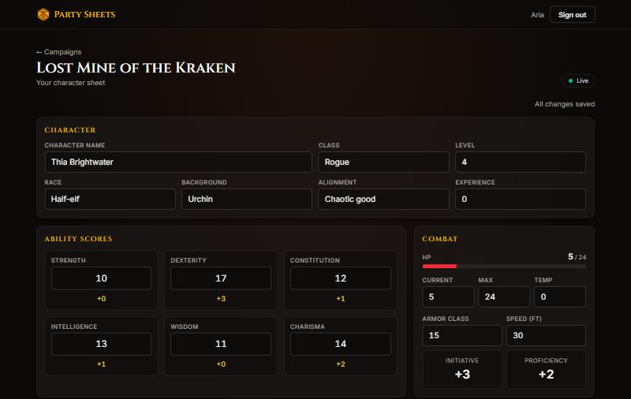
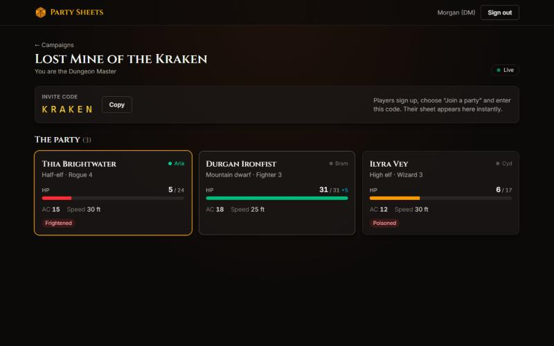

# Party Sheets

Realtime D&D character sheets for your whole party. Players keep their own sheets up to date;
the Dungeon Master watches every sheet in the campaign change live: HP, conditions, AC and
the rest, with no refresh.

| Player's sheet (autosaves as you type) | DM's party board (live over WebSockets) |
| --- | --- |
|  |  |

> Built as a pair-programming project with an AI assistant (Claude Code). The full,
> step-by-step build log, including decisions, dead ends and how they were fixed, is in
> [`docs/DEVLOG.md`](docs/DEVLOG.md).

## Features

- **Accounts:** register and sign in; the session is a JWT in an `httpOnly` cookie.
- **Campaigns:** create one (you become the DM and get a 6-character invite code) or join one
  with a code. Campaigns you've joined before are listed on your dashboard.
- **Character sheets:** identity, ability scores with derived modifiers, HP/temp HP, AC, speed,
  initiative, proficiency bonus, 5e conditions, inventory and notes. Changes autosave with a
  debounce, and saves never overlap.
- **Live DM view:** every player's sheet appears as a card that updates the instant the player
  saves, with online/offline presence and a highlight on change. Click a card to open the full
  sheet and edit it (apply damage, add a condition); the player sees the change live.
- **No lost edits:** saves carry the version they're based on, and a stale save gets `409`.
  The client then merges both people's edits field by field (three-way merge) and retries, so
  a DM and a player editing the same sheet at once both keep their changes.
- **Privacy by design:** players only ever receive their own sheet. This is enforced on the
  server for both REST and WebSocket fan-out, and covered by tests.

## Tech stack

| Layer | Choice |
| --- | --- |
| Language | TypeScript end to end, npm workspaces monorepo |
| Shared | `zod` schemas and the typed Socket.IO event contract, used by both sides |
| Server | Node 24, Express 5, Socket.IO 4, Prisma 7 (SQLite in dev), bcrypt, JWT, helmet, rate limiting |
| Client | React 19, React Router 7, Vite 8, Tailwind CSS 4 |
| Tests | Vitest: unit tests for shared logic, plus Supertest + socket.io-client integration tests against a real database |
| CI | GitHub Actions: typecheck, test, build |

## Architecture

```
client (React)                         server (Express + Socket.IO)               SQLite (Prisma)
──────────────                         ────────────────────────────               ───────────────
PUT /api/sheets/:id  ───────────────▶  validate (zod) → authorise (owner only)
                                       → persist, version++  ─────────────────▶  Sheet row
                                       → notifier.sheetUpdated(sheet)
                                             │
socket 'sheet:updated'  ◀────────────────────┤  emitted only to:
  (DM's party board,                         │   • room user:<ownerId>          (owner's other tabs)
   owner's other tabs)                       └─  • room campaign:<id>:dm        (the DM)
```

- **Writes go through REST, reads fan out over WebSockets.** Every write takes one validated,
  authorised path; the socket layer only distributes the result.
- **Rooms encode permissions.** A socket joins `campaign:<id>` only after a membership check,
  and only the DM also joins `campaign:<id>:dm`. Sheets are never broadcast to the whole campaign.
- **Versioned sheets.** Each save bumps `version`; clients drop out-of-order events, and after a
  reconnect they refetch to catch anything they missed.
- **Routes don't import Socket.IO.** They depend on a small `RealtimeNotifier` interface, which
  keeps them testable and the transport swappable.

```
party-sheets/
├── shared/   zod schemas, API types, socket event contract
├── server/   Express API, Socket.IO, Prisma schema/migrations, seed, tests
├── client/   React app
└── docs/     DEVLOG (build log) and screenshots
```

## Running locally

Requires Node 20+ (developed on Node 24).

```powershell
npm install
```

```powershell
Copy-Item server/.env.example server/.env
```

Then set `JWT_SECRET` in `server/.env` to a long random string. This prints one:

```powershell
node -e "console.log(require('crypto').randomBytes(48).toString('hex'))"
```

Create the database, load the demo campaign and start both apps:

```powershell
npm run db:migrate
```

```powershell
npm run db:seed -w server
```

```powershell
npm run dev
```

Open http://localhost:5173. The seed prints the demo accounts (one DM and three players, all
sharing a password, listed at the top of [`server/prisma/seed.ts`](server/prisma/seed.ts)).
To see the realtime view, sign in as the DM in one browser and as a player in another (or in a
private window), then edit the player's HP.

### Scripts

| Command | What it does |
| --- | --- |
| `npm run dev` | API on :3001 and Vite on :5173 (proxying `/api` and `/socket.io`) |
| `npm test` | Shared unit tests, then server integration tests on a throwaway `test.db` |
| `npm run typecheck` | `tsc --noEmit` across all workspaces |
| `npm run build` | Bundle the server (tsup) and the client (Vite) |
| `npm run db:migrate` | Apply/create Prisma migrations for `dev.db` |

## Roadmap

Candidates for the next iterations:

- Show who made the last change ("Your DM set HP to 7")
- Spells, attacks, skills and saving throws on the sheet
- Initiative tracker and party-wide dice log
- Postgres + Docker Compose, then deploy (API and client served from one origin)
- Client tests (React Testing Library) and a Playwright end-to-end run in CI
